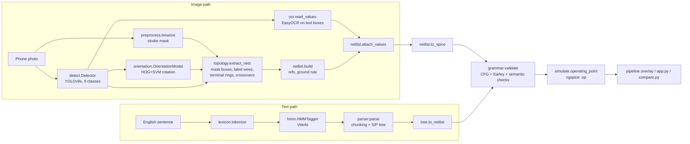

# CircuitVision Project Bible

The permanent technical reference, onboarding guide and handover document for CircuitVision.

| | |
|---|---|
| Last updated | 2026-10-23 |
| Written against commit | `c3dfdb1` on `main` |
| Owner | Pranshu Kumar (VJTI, B.Tech EXTC, AI/ML minor) |
| Repository | https://github.com/sudo-pranshu/CircuitVision (public) |
| Day-to-day status | [`PROJECT_STATUS.md`](PROJECT_STATUS.md). Read that first for "what's happening now". |

**How to read this document.** Section 1 is the plain-language version. Sections 2–5 explain how the system works. Sections 6–8 cover data, setup and Git. Sections 9–13 record history, status, open work and results. Sections 14–16 cover limitations, onboarding and rules.

**Status labels used everywhere:**
- **REAL CGHD**: measured on the real dataset. *No such result exists yet.*
- **SYNTHETIC / CONTROLLED**: measured on data generated by our own code, where the right answer is known.
- **HAND-WRITTEN NLP EVALUATION**: measured on sentences we wrote ourselves.
- **UNTESTED**: implemented, but no measurement exists.

Statements marked **(assumption)** are not verified facts.

---

## Contents

1. [Project overview](#1-project-overview)
2. [Architecture](#2-architecture)
3. [Repository structure](#3-repository-structure)
4. [Technical implementation reference](#4-technical-implementation-reference)
5. [NLP (text → netlist) reference](#5-nlp-text--netlist-reference)
6. [Dataset reference (CGHD)](#6-dataset-reference-cghd)
7. [Development environment](#7-development-environment)
8. [Git and collaboration workflow](#8-git-and-collaboration-workflow)
9. [Development history](#9-development-history)
10. [Current status](#10-current-status)
11. [Pending work and ownership](#11-pending-work-and-ownership)
12. [Experiment and results registry](#12-experiment-and-results-registry)
13. [Report and presentation](#13-report-and-presentation)
14. [Known problems and limitations](#14-known-problems-and-limitations)
15. [Teammate onboarding checklist](#15-teammate-onboarding-checklist)
16. [Rules for future development](#16-rules-for-future-development)

---

## 1. Project overview

### 1.1 Identity

- **Name:** CircuitVision
- **Full title:** *CircuitVision: Automated Conversion of Hand-Drawn Circuit Diagrams into Validated, Simulatable SPICE Netlists using Computer Vision, Image Processing and NLP*
- **Academic context:** final-year B.Tech EXTC mini-project for the AI/ML minor at VJTI Mumbai. The faculty constraint was that the project must be built on image processing, computer vision or NLP, and must not be a generic "AI" project.

### 1.2 Problem statement

Students and engineers sketch circuits on paper. To simulate one, somebody has to retype it as a SPICE netlist (a text list of components and the nodes they connect to). That retyping is slow, and it is error-prone in exactly the places that matter: a swapped node, a missed junction, a diode the wrong way round.

CircuitVision takes a **phone photo of a hand-drawn circuit**, or an **English sentence describing a circuit**, and produces a SPICE netlist. It then checks that netlist with a formal grammar and semantic rules, and simulates it with ngspice.

### 1.3 Beginner-friendly explanation (for a teammate)

Think of a circuit drawing as a map. The components are cities, and the wires are roads.

1. **Find the cities.** A trained object detector (YOLO) draws a box around every resistor, capacitor, diode and so on.
2. **Find the roads.** We turn the photo into black ink on white paper, erase everything inside the component boxes, and what remains is wire. Each separate piece of wire is one electrical "net" (node).
3. **Work out which roads reach which city.** We look just outside each box to see which wire pieces touch it. A resistor touching nets 1 and 2 becomes `R1 1 2`.
4. **Read the signs.** OCR reads labels like "10k", and each label is attached to the nearest suitable component.
5. **Write the netlist, proof-read it, and run it.** A grammar checks the syntax. Rules check for things like a floating node or a missing ground. ngspice then computes the voltages.

The text path does the same job from a sentence such as *"a 9V battery driving a 1k resistor in series with a 2k resistor"*:
1. A statistical tagger labels each word (value, resistor, "series", …).
2. A parser builds a series/parallel tree from the tagged words.
3. The tree is turned into a netlist.

### 1.4 Technical explanation

The image path combines three things:
- **Classical image processing:** paper-relative binarization, morphology, connected components and union-find. This handles topology.
- **A deep detector:** YOLOv8s with 9 classes, trained on CGHD.
- **A small learned classifier:** HOG features with a linear SVM. It predicts the rotation of polarized symbols, and the rotation decides terminal polarity.

The NLP side has two separate uses:
1. A **context-free grammar with an Earley recognizer** validates every netlist, from either path.
2. A **first-order HMM tagger** (add-k smoothing, Viterbi decoding, shape back-off) and a rule-based **series/parallel semantic parser** turn English into a circuit tree.

Evaluation separates detector errors from downstream errors:
- **GT-box mode** uses the ground-truth boxes.
- **Detector mode** uses the trained detector's boxes.

### 1.5 Why this is CV, image processing and NLP

| Area | Where it appears |
|---|---|
| Image processing | Binarization (grey closing, relative contrast, Otsu), morphology, connected components, ring sampling around boxes, EXIF handling |
| Computer vision | YOLOv8 object detection; HOG + SVM orientation classifier; EasyOCR |
| NLP | HMM POS-style tagging with Viterbi; chunking; series/parallel semantic parsing; CFG + Earley parsing of the netlist language; semantic (constraint) checks |

The module-by-module mapping to the AI/ML course is in [`README.md`](../README.md#module-map).

### 1.6 Objectives

1. Detect circuit components in real hand-drawn photos (CGHD) with a reproducible YOLOv8s baseline.
2. Recover the circuit topology (nets) from the photo, including junctions and wire crossovers.
3. Read component values with OCR and attach them to the right components.
4. Emit SPICE that passes a formal grammar and semantic checks, and simulates in ngspice.
5. Provide a second, text-based input path using classical NLP.
6. Evaluate every stage honestly: separate GT-box and detector results, and keep real and synthetic results apart.

**Target users:** students checking homework circuits, instructors, and anyone digitising sketches.

### 1.7 Expected final output

For each input (photo or sentence):
- a `.cir` netlist;
- a validation verdict;
- the ngspice DC operating point;
- for photos, an overlay image with each net coloured.

A Gradio web demo wraps the image path ([`src/circuitvision/app.py`](../src/circuitvision/app.py)). The academic deliverables are the report, the slides and the evidence bundle from the real experiment.

### 1.8 Scope

**Supported component classes** (YOLO class ids 0–8, [`classes.py`](../src/circuitvision/classes.py)):

| Id | Class | Becomes a netlist element? |
|---|---|---|
| 0 | `resistor` | yes (`R`, default `1k`) |
| 1 | `capacitor` | yes (`C`, default `1u`) |
| 2 | `inductor` | yes (`L`, default `1m`) |
| 3 | `voltage_source` | yes (`V`, default `DC 5`) |
| 4 | `diode` | yes (`D`, model `DMOD`) |
| 5 | `gnd` | no: marks node 0 |
| 6 | `junction` | no: a wire dot, treated as wire |
| 7 | `crossover` | no: wires cross without connecting |
| 8 | `text` | no: a value label for OCR |

**Not supported:**
- transistors, ICs and op-amps;
- switches, lamps, AC sources (`voltage.ac`), current sources;
- any element with more than two terminals.

These symbols are recognised only as "other" (from ground-truth annotations) so that their ink is masked during wire tracing. The detector does not learn them.

The text path supports series/parallel descriptions only. It cannot express bridges or named nodes.

---

## 2. Architecture

### 2.1 Diagram



### 2.2 Image path, stage by stage

The function that runs the whole image path is `pipeline.run(img, dets, info)`. `pipeline.main` and `app.py` add detection, OCR, orientation, output writing and simulation around it.

| # | Stage | Input → output | Module | Key assumptions | On failure |
|---|---|---|---|---|---|
| 1 | Load | path → BGR array | `preprocess.load` | OpenCV applies EXIF on read | Raises `FileNotFoundError` |
| 2 | Binarize | BGR → uint8 mask (255 = ink) | `preprocess.binarize`, `remove_small_blobs` | Dark ink on lighter paper | A bad mask gives wrong nets; the error stays silent until validation or comparison |
| 3 | Detect | BGR → `list[Detection]` (class, box, conf) | `detect.Detector` (conf 0.35) | Weights trained on the 9 classes | Missed symbols become wires; extra symbols cut wires |
| 4 | Orientation | crops → `Detection.rotation` ∈ {0,90,180,270} | `orientation.OrientationModel.annotate` | Convention set at Gate 1 | No model → polarity falls back to geometric order (left→right, top→bottom) |
| 5 | Wire tracing | mask + detections → `{det index: [net ids]}`, label image | `topology.extract_nets` | Two-terminal parts; wires leave boxes on box sides | A part with ≠2 terminals gets a `* WARNING` comment and is skipped |
| 6 | Netlist build | detections + nets → `list[Component]` | `netlist.build` | Ground rule (§4.11) | — |
| 7 | OCR + values | text boxes → `Detection.text` → `Component.value` | `ocr.read_values`, `netlist.attach_values` | Labels near their element; allowlist of digits and units | Unread or unmatched → default value (§4.12) |
| 8 | SPICE text | components → netlist string | `netlist.to_spice` | — | — |
| 9 | Validate | string → list of errors (empty = valid) | `grammar.validate` | Our SPICE subset only | Errors are reported; simulation is skipped in `app.py` |
| 10 | Simulate | string → `{v(n): volts, vX#branch: amps}` | `simulate.operating_point` | ngspice on `PATH` | Raises `RuntimeError` with ngspice's last lines |
| 11 | Visualize | image + nets → overlay PNG | `pipeline.overlay` | — | — |

**Implemented vs experimental:** every stage is implemented and unit-tested. No stage has been measured on real CGHD photos yet (§10).

### 2.3 Text path, stage by stage

| # | Stage | Input → output | Module |
|---|---|---|---|
| 1 | Tokenize | sentence → tokens (keeps `4k7`, `1N4148`, `,`, `(`, `)` whole) | `nlp/lexicon.tokenize` |
| 2 | Tag | tokens → tags from {SRC, RES, CAP, IND, DIO, VAL, UNIT, SER, PAR, SEP, O} | `nlp/hmm.HMMTagger.tag` (model `nlp/hmm_tagger.json`) |
| 3 | Chunk + parse | tokens + tags → (source entity, series/parallel tree) | `nlp/parser.parse` |
| 4 | Netlist | tree → SPICE (source across the whole load) | `nlp/tree.to_netlist` |
| 5 | Validate / simulate | shared with the image path | `grammar.py`, `simulate.py` |

Entry point: `nlp/text2netlist.text_to_netlist(text)`. Details are in §5.

### 2.4 How the modules communicate

Everything is in-process Python, with no services involved. The shared data types are in [`types.py`](../src/circuitvision/types.py):
- **`Detection`:** `cls`, `box` (x1, y1, x2, y2 in pixels), `conf`, `text`, `rotation`, `mirror`.
- **`Component`:** `ref`, `cls`, `box`, `nets`, `value`.

The netlist **string** is the interface between the front ends (image and text) and the shared back end (grammar, simulation, comparison).

---

## 3. Repository structure

```
CircuitVision/
├── README.md                 public overview, setup, usage, module map
├── EXPERIMENTS.md            experiment protocol, gates, findings, what each metric means
├── pyproject.toml            package + optional extras (detect, app, dev)
├── .gitignore                ignores /data /runs /out /experiments *.pt *.zip *.cache
├── docs/
│   ├── PROJECT_BIBLE.md      this document
│   └── PROJECT_STATUS.md     short, frequently updated status
├── examples/                 divider.png + divider.xml (smoke-test input with GT boxes)
├── notebooks/
│   └── train_colab.ipynb     the real CGHD experiment (baseline_v1), with gates
├── scripts/
│   ├── pin_opencv.sh         leaves exactly one OpenCV build (headless 4.10.0.84)
│   └── check_opencv.py       verifies cv2.HOGDescriptor / ml.SVM before GPU steps
├── results/                  committed, small, synthetic/controlled results only
├── src/circuitvision/        the package (see table below)
│   └── nlp/                  text → netlist
└── tests/                    pytest suite (107 tests at c3dfdb1)
    ├── data/cghd_real/       ONE real CGHD annotation (C145_D1_P1.xml), CC BY 3.0
    └── fake_cghd.py          tiny CGHD-format fixture generator
```

**Not in the repository** (ignored by Git on purpose): `data/` (datasets), `runs/` (training runs), `out/` (pipeline outputs), `experiments/` (experiment folders), `*.pt` (weights), `*.zip`. The real experiment lives on Google Drive under `MyDrive/CircuitVision/`.

### 3.1 Package modules (`src/circuitvision/`)

| File | Purpose |
|---|---|
| `types.py` | `Detection` and `Component` dataclasses |
| `classes.py` | The 9 classes, explicit CGHD → class map, `OTHER`, SPICE prefixes and default values |
| `preprocess.py` | `load`, `binarize`, `remove_small_blobs` |
| `cghd_to_yolo.py` | VOC XML parsing (`parse_voc`), EXIF handling (`exif_orientation`, `load_for_annotation`), YOLO export split by drafter (`convert`) |
| `audit.py` | Full dataset audit: drafters, classes, boxes, fields, rotation statistics, EXIF, mirror, dataset docs; parallel image pass with progress |
| `visualize.py` | Rotation sheets (Gate 1) and stratified YOLO label overlays (Gate 2) |
| `detect.py` | `Detector`: ultralytics YOLO inference → `Detection` list |
| `train.py` | Fixed `BASELINE` config; `--auto` resume/skip; writes `train_config.json` |
| `detector_eval.py` | Test-split metrics (P, R, AP50, AP50-95 per class), confusion matrix, per-image errors, qualitative folders |
| `orientation.py` | Rotation convention, `from_cghd`, `positive_side`, HOG + linear-SVM `OrientationModel`, training CLI |
| `topology.py` | `extract_nets`: wire tracing, crossovers, terminal ordering; `symbol_scale` |
| `ocr.py` | `read_values`: EasyOCR with a digit/unit allowlist |
| `netlist.py` | `parse_value` (units, RKM codes), `attach_values`, `build` (refs and ground), `to_spice` |
| `grammar.py` | CFG, Earley recognizer, `validate` (syntax + semantics) |
| `simulate.py` | ngspice batch `.op` → dict |
| `compare.py` | Graph isomorphism and operating-point comparison against a reference netlist |
| `pipeline.py` | `run`, `trace`, `overlay`, `detections_from_xml`; CLI |
| `app.py` | Gradio demo (`build_ui`) |
| `evaluate.py` | Stage-wise downstream evaluation (GT-box and detector modes, in-scope subset, proxies) |
| `report_tables.py` | Builds `tables.md` from artifacts only; prints NOT AVAILABLE where an artifact is missing |
| `synth.py` | Synthetic circuits with known graphs: topology benchmark (11 conditions) and CGHD-shaped test trees |
| `nlp/lexicon.py` | Tag set, tokenizer, word shapes, value parsing for text |
| `nlp/hmm.py` | `HMMTagger` (fit, Viterbi tag, save/load), `tag_report` |
| `nlp/corpus.py` | Synthetic tagged training corpus (templates; held-out phrasings) |
| `nlp/parser.py` | Chunking and series/parallel structure |
| `nlp/tree.py` | Tree representation, canonical form, `to_netlist` |
| `nlp/text2netlist.py` | `text_to_netlist`; CLI (`train` or a sentence) |
| `nlp/evaluate.py` | Evaluation on the frozen hand-written sets |
| `nlp/data/*.jsonl` | Frozen hand-written evaluation sets (30 and 20 sentences) |
| `nlp/hmm_tagger.json` | Trained tagger parameters (small; committed) |

There is no `docs/` content apart from these two files, and no `data/` or `runs/` folder in Git.

### 3.2 Tests (`tests/`)

| File | Covers |
|---|---|
| `test_cghd_format.py` | Real XML fixture (rotation inside `<bndbox>`), mirror, EXIF frames, implicit ground |
| `test_dataset.py` | CGHD → YOLO conversion counts and labels |
| `test_audit_images.py` | Fast header-based image sizes equal two full decodes, for all 8 EXIF orientations |
| `test_orientation.py` | Convention maths, training and prediction on fixtures |
| `test_topology.py` | Wire tracing on synthetic renders (scale, grid, shadow, crossovers, junction dots) |
| `test_pipeline.py` | End to end on drawn fixtures |
| `test_grammar.py`, `test_simulate.py`, `test_compare.py` | Validator, ngspice, isomorphism and operating-point comparison |
| `test_evaluate.py`, `test_detector_eval.py` | Evaluation harnesses on the fake CGHD tree |
| `test_text2netlist.py` | Tagger and parser on development sentences (not the frozen sets) |
| `test_colab_support.py` | Training resume-state detection; Gate 2 sample coverage |

---

## 4. Technical implementation reference

### 4.1 Class mapping (CGHD → CircuitVision)

`classes.CGHD_MAP` is an explicit dictionary, not prefix matching. Every in-scope label is listed individually:

| CGHD labels | Class | Note |
|---|---|---|
| `resistor`, `resistor.adjustable`, `resistor.photo` | resistor | drawn as a two-terminal resistor body |
| `capacitor.unpolarized`, `capacitor.polarized` | capacitor | capacitor polarity is not modelled |
| `inductor` | inductor | |
| `voltage.dc`, `voltage.battery` | voltage_source | `voltage.ac` is excluded (it would simulate as DC) |
| `diode`, `diode.light_emitting`, `diode.zener` | diode | zener breakdown is not modelled |
| `gnd`, `junction`, `crossover`, `text` | same name | |

Everything else maps to `None` for YOLO training. With `parse_voc(keep_other=True)` it maps to `OTHER`, which is used only to mask that symbol's ink during wire tracing.

### 4.2 Annotation and label formats

- **CGHD (Pascal VOC XML).** One `<object>` per symbol, with `<name>` (the label) and `<bndbox>` holding `xmin`, `ymin`, `xmax`, `ymax`. In the real format, **`<rotation>` sits inside `<bndbox>`**, in whole degrees. `parse_voc` reads `rotation` and `mirror` (or `mirrored`) through `_field`, which checks `bndbox` first and then the object. A `<text>` field holds the label string for text objects.
- **YOLO.** Each line is `class cx cy w h`, normalised to [0, 1] by the XML `<size>`. Boxes are clipped to the image; clipped and dropped boxes are counted in `conversion_stats.json`.
- **Internal boxes.** `(x1, y1, x2, y2)` in integer pixels, in the annotation's pixel frame.

### 4.3 EXIF handling

Phone photos can carry an EXIF orientation tag. `load_for_annotation(path, w, h)` decodes an image in the pixel frame its XML refers to. It picks the raw or EXIF-rotated frame by matching the XML `<size>` and returns a frame tag: `upright`, `displayed`, `raw`, `ambiguous` or `mismatch`.

During conversion, images with an EXIF tag other than 1 are re-encoded without EXIF in the annotation frame. They are listed in `conversion_stats.json → exif_reencoded`, and Gate 2 always shows some of them.

### 4.4 Rotation and polarity convention

- **Internally,** `rotation` is in degrees counter-clockwise, one of 0/90/180/270. At rotation 0 the positive terminal (diode anode, source +) is on side `PLUS_AT_0`.
- **CGHD's** `<rotation>` is rounded to the nearest 90° by `from_cghd`, and negated if `CGHD_CLOCKWISE`.
- **Configuration:** the environment variables `CIRCUITVISION_PLUS_AT_0` (left/right/top/bottom) and `CIRCUITVISION_CGHD_CLOCKWISE` (0/1). **The code defaults (`left`, counter-clockwise) are unverified assumptions.** The real values are set at **Gate 1** from the real rotation sheets and the dataset's own scripts.
- **What is already known:** in real annotations, wide resistor boxes have rotation ≈ 0 and tall ones ≈ 90, so 0° means horizontal for resistors. The direction of rotation and the + side cannot be read from box shapes.
- **Mirrored polarized symbols** are excluded from orientation training and scoring, and counted.
- **Classifier:** 64×64 squared grayscale crop → HOG (16×16 blocks, 8×8 cells, 9 bins) → OpenCV linear SVM. There is one model per polarized class. Every training crop is also rotated by 90, 180 and 270 degrees, with the label shifted to match.

### 4.5 Preprocessing (`binarize`)

1. Convert to grayscale and apply a 5×5 Gaussian blur.
2. Estimate the paper by grey-level **closing** with a square kernel, `k = max(15, min(h, w) // 15)`, forced odd. The closing removes dark features thinner than k (strokes, grid lines, text) and follows shadows.
3. Compute contrast relative to the paper: `(paper − pixel) / paper` on a 0–255 scale.
4. Threshold with Otsu on the contrast values above a floor of 12, then apply a 2×2 opening.
5. `remove_small_blobs` drops 8-connected components under 30 px.

### 4.6 Wire tracing (`topology.extract_nets`)

1. **Scale.** `s = symbol_scale(dets)` is the median short side of the element boxes divided by 24 (minimum 1). Every size parameter scales with it: ring `pad = 6s`, `gap_close = max(3, 3s)`, box `inflate = 3s`, `min_wire = 40s²`.
2. **Mask.** Erase every box of class resistor, capacitor, inductor, voltage_source, diode, gnd, crossover, text or other, after inflating it. Junctions are not erased, so a junction dot joins its wires.
3. **Label.** Dilate the remaining ink by `gap_close` to bridge pen gaps, then label 8-connected components. Drop components smaller than `min_wire`, and drop "slivers": fragments that never leave the neighbourhood of a single box (pieces of a symbol's outline).
4. **Crossovers.** For each crossover box, union the wire labels on its left and right sides, and separately on its top and bottom sides. Crossing wires therefore stay unconnected.
5. **Terminals.** For each masked box (not text or crossover), collect the wire labels in a ring of width `pad` on each side. Nets are ordered as follows:
   - **Known polarity:** the + side, then the opposite side.
   - **Otherwise, wide boxes:** left, right, top, bottom.
   - **Otherwise, tall boxes:** top, bottom, left, right.
6. **Numbering.** Nets are renumbered compactly from 1.

The ground net becomes 0 later, in `netlist.build`.

### 4.7 OCR and value attachment

- **OCR.** `ocr.read_values` runs EasyOCR (English) on each text box padded by 4 px. Crops taller than 1.5× their width are rotated upright. The allowlist is `0123456789.,kKmMuµnpGRrFfHhVvΩ`. The reader is created lazily; the first use downloads its weights.
- **Value parsing.** `netlist.parse_value` handles:
  - decimal comma (`4,7` → `4.7`);
  - SI prefixes (`µ`, `μ` → `u`; `K` → `k`; `M` → `meg`);
  - RKM codes (`4k7` → `4.7k`, `2R2` → `2.2`, `1M5` → `1.5meg`);
  - unit suffixes (Ω/ohm → resistor, F → capacitor, H → inductor, V → source).
  It returns the value and the class implied by the unit. Labels such as `R1` parse to nothing.
- **Attachment.** `attach_values` uses greedy one-to-one matching, closest pairs first. A label is a candidate only if its unit agrees with the element's class. The distance limit is `max(150, 1.5 × the element's longer box side)`.

### 4.8 Reference and node naming

- **References** are a prefix plus a counter, in detection order: `R1, R2, C1, L1, V1, D1`.
- **Nets** are integers from 1; ground is `0`.
- **Netlist title** is `* <title>`, followed by comment lines, including `* ground: <rule>`.

### 4.9 Netlist syntax (what `to_spice` emits)

```
* divider
* ground: symbol
V1 1 0 DC 5
R1 1 2 10k
R2 2 0 1k
.model DMOD D          (only if a diode is present)
* WARNING X: found N terminals [...], skipped   (if any)
.op
.end
```

### 4.10 Default values

`classes.SPICE` defines the defaults used when no value is attached: R `1k`, C `1u`, L `1m`, V `DC 5`, D `DMOD`. A defaulted value is a placeholder, not a reading. With the GT-box oracle (§4.15), CGHD `<text>` values are used instead.

### 4.11 Ground handling

`netlist.build` decides ground with these rules, in order:
1. **Symbol.** Any net touching a `gnd` box becomes node 0.
2. **Otherwise, first source.** The second terminal of the first voltage source becomes node 0. With known polarity this is the − terminal; otherwise it is whatever came second geometrically.
3. **Otherwise, most connected net.**

The rule applied is written into `info["ground"]` and into the netlist header. Rules 2 and 3 are **assumptions**: they pick a reference node, which does not change any voltage *difference*. `compare.py` compares element voltages, so it is independent of which node is ground.

### 4.12 CFG and Earley parser (`grammar.py`)

- **Grammar** (non-terminals in capitals):
  - `S → TITLE EOL BODY ENDLINE | TITLE EOL ENDLINE`
  - `BODY → LINE | LINE BODY`
  - `LINE → STMT EOL`
  - `STMT → R | C | L | V | D | MODEL | dotop | comment`
  - `R → rname node node value` (C and L likewise)
  - `V → vname node node SRC`, with `SRC → value | dc value`
  - `D → dname node node ident`
  - `MODEL → dotmodel ident ident`
  - `ENDLINE → dotend EOL`
- **Terminals** are regex predicates on raw tokens. An ambiguous token such as `1` can be a node or a value, and Earley keeps both readings alive.
- **The recognizer** is a textbook predict/scan/complete over chart sets (the grammar has no epsilon rules). It reports the first token at which the chart empties, so the error message names a line.
- **Semantic checks** after a successful parse:
  - duplicate references;
  - no node 0;
  - floating nodes (degree < 2);
  - shorted elements (both terminals on one node);
  - diodes using an undefined model.

### 4.13 ngspice integration

`simulate.operating_point` strips any `.op` and `.end`, appends `.control / op / print all / .endc / .end`, and runs `ngspice -b` with a 20 s timeout. It parses lines of the form `v(n) = …` and `x#branch = …`. If nothing parses, it raises `RuntimeError` with ngspice's last three lines.

### 4.14 Comparison against a reference (`compare.py`)

- **`topology_match`:** the graphs are isomorphic when values are ignored. The test backtracks over net mappings, and polarized parts keep terminal order.
- **`exact_match`:** isomorphic, and the values are equal as floats.
- **`op_match`:** each element's voltage agrees in both ngspice runs (relative tolerance 1e-3, absolute 1e-6). This does not depend on which node is ground.

### 4.15 Evaluation metrics

**Detector** (`detector_eval.py`, test split = drafter 12): ultralytics `val` gives precision, recall, mAP@0.5 and mAP@0.5:0.95, overall and per class, plus the confusion matrix and plots. It also records per-image TP, FP, FN and confusions at confidence 0.25 (IoU 0.5), and qualitative folders.

**Downstream** (`evaluate.py`) has two modes, always reported separately:
- **`gt_boxes`:** GT boxes, GT rotation and GT text as oracle inputs. This isolates topology.
- **`detector`:** detector boxes (conf 0.35), with rotation from `--orient` and text from `--ocr`.

| Metric | Meaning | Caveat |
|---|---|---|
| orientation accuracy | vs GT `<rotation>` binned to 90°, mirrored excluded | Only as valid as the Gate 1 convention |
| OCR exact / char accuracy | vs GT `<text>` on GT text boxes; all labels and value-like labels | Names like `R1` can't be read with the value allowlist |
| `topology_terminals_ok_PROXY` | share of elements with exactly 2 terminals | Plausibility, not correctness |
| `consistency_PROXY` | the photos of one drawing give isomorphic netlists | Consistent ≠ correct |
| `vs_reference` | topology/exact/op match where `references/<stem>.cir` exists | Real CGHD v14 has no reference graphs |
| `netlist_valid`, `simulates` | grammar + semantics pass; ngspice returns | Valid ≠ right circuit |
| `isomorphic_to_gt_boxes` | detector netlist equals the GT-box netlist | Isolates detection errors |

Every metric is also reported on the **in-scope-only subset**: images with no out-of-scope symbols.

---

## 5. NLP (text → netlist) reference

- **Tag set:** SRC, RES, CAP, IND, DIO, VAL, UNIT, SER, PAR, SEP, O.
- **Tokenizer:** a regex that keeps RKM codes (`4k7`) and part numbers (`1N4148`) whole and emits `,`, `(` and `)` as tokens.
- **HMM** ([`nlp/hmm.py`](../src/circuitvision/nlp/hmm.py)):
  - first-order, with add-k smoothing (k = 0.1) and Viterbi decoding in numpy;
  - unknown words back off to a case-aware shape class;
  - training applies 5 % word dropout, and maps words seen once to their shape, so the back-off classes get emission mass.
  - It is trained on 3,000 synthetic sentences from [`nlp/corpus.py`](../src/circuitvision/nlp/corpus.py) (`python -m circuitvision.nlp.text2netlist train`).
- **Parser** ([`nlp/parser.py`](../src/circuitvision/nlp/parser.py)):
  - **Chunking:** a noun takes the nearest free value to its left, otherwise to its right. UNIT tokens are glued to the value before them. A count word ("two 1k resistors") repeats the element.
  - **Structure:** parentheses group explicitly. A comma followed by an operator closes everything before it into one operand ("A and B in parallel, in series with C" → S(P(A,B),C)). List form gives "A, B and C in series". Otherwise the chain form attaches to the right.
  - The source is pulled out and placed across the load.
- **Tree** ([`nlp/tree.py`](../src/circuitvision/nlp/tree.py)): `("E", cls, value)`, `("S", [...])` or `("P", [...])`. Nested nodes of the same kind are flattened. The canonical form treats parallel branches as unordered and keeps series order.
- **Evaluation sets** (frozen; do not tune against them):
  - [`handwritten_eval.jsonl`](../src/circuitvision/nlp/data/handwritten_eval.jsonl): 30 sentences. **It was later used for error analysis while improving the parser, so its post-change score is optimistic.**
  - [`handwritten_fresh.jsonl`](../src/circuitvision/nlp/data/handwritten_fresh.jsonl): 20 sentences, written after development and evaluated once.

---

## 6. Dataset reference (CGHD)

### 6.1 Official identity (from the dataset's publication and Zenodo record)

- **Name:** CGHD, *A Public Ground-Truth Dataset for Handwritten Circuit Diagram Images*. F. Thoma, J. Bayer, Y. Li, A. Dengel, ICDAR 2021.
- **License:** CC BY 3.0.
- **Version used:** Zenodo record **14042961** (v14), file `cghd-zenodo-14.zip`, about 4.4 GB, MD5 `ab1cde6feb5edaafbde711cd2059a2f4`. These values come from the Zenodo record and are enforced by the notebook.
- **Newer release:** v16 (record 17469897, about 4.9 GB, 2025). It is deliberately not used, so the experiment stays reproducible.
- **Structure:** `drafter_N/annotations/*.xml` and `drafter_N/images/*`. Files are named `C<circuit>_D<drawing>_P<photo>`, and several photos show the same drawing.
- **The paper's split:** train on drafters 1–20 and 25, validate on 21–22, test on 23–24. **Ours differs** (§6.3).

### 6.2 What we actually inspected

| Item | Evidence | Verified on the full dataset? |
|---|---|---|
| Real XML format: rotation inside `<bndbox>`, 1° resolution, mirror field | `drafter_13/C145_D1_P1.xml` (committed fixture, taken from the Hugging Face copy, not the MD5-checked zip) and `drafter_1/C1_D1_P1.xml` | **No.** Two files only. |
| Resistor rotation ≈ 0 means a horizontal box | Those two files | **No.** The audit's aspect table will check this on all files. |
| About 1,437 mirror annotations | Reported for the latest release | **No.** Not counted on v14 yet. |
| Number of drafters, images, objects, class counts, EXIF frequency | — | **No.** These are produced by the audit (`audit/audit.md`) on Colab. |
| Zip integrity | MD5 check in the notebook | Only once the notebook runs. |

**There has been no full audit yet.** Every count in this document that would come from the audit is deliberately left out.

### 6.3 Our split and configuration

The split is by drafter, so no person's handwriting appears in both training and test:
- **validation:** `drafter_11`
- **test:** `drafter_12`
- **train:** all other drafters

This was fixed before any training. Results are therefore not directly comparable with the paper's numbers.

### 6.4 Download, verification, storage

The notebook handles all of this (cell "Dataset"):
1. Download once to `MyDrive/CircuitVision/data/cghd-zenodo-14.zip`, via a `.part` file so that a partial download never looks complete.
2. On every run, copy the zip to local disk (`/content`), check its MD5, and extract it to `/content/cghd`. All reads are local.
3. If the MD5 is wrong, the cell stops and tells you to delete the cached zip.

The dataset is **never committed to Git**: it is about 4.4 GB, carries its own license and attribution, and Git is not a data store. `.gitignore` blocks `/data/` and `*.zip`. The only CGHD file in the repository is the single annotation fixture, with attribution in [`tests/data/cghd_real/README.md`](../tests/data/cghd_real/README.md).

### 6.5 Audit process (`audit.py`)

The audit reads every XML and every image and writes `audit.json`, `audit.md`, `raw_xml_samples.txt` and `dataset_docs/`. It assumes nothing from the documentation. It reports:
- drafters and splits;
- raw and mapped class counts;
- the fields seen in `<object>` and `<bndbox>`;
- rotation values and their binning, plus the aspect-by-rotation table;
- mirror counts and text examples;
- image sizes against the XML `<size>`, raw and EXIF-applied, and EXIF orientation counts;
- file types, and drafter sub-folders.

It also copies the dataset's own scripts and docs into `dataset_docs/`.

**Speed:** JPEG sizes come from the file header, and readability comes from one decode at 1/8 scale. This was verified against two full decodes in `test_audit_images.py`. The image pass runs on all CPU cores and prints `Audited N/total` every 100 images. In a measurement on a 2-vCPU machine with 6 MB phone photos, the time per image fell from 370 ms to 36 ms.

---

## 7. Development environment

### 7.1 Supported setups

| Environment | Use | Notes |
|---|---|---|
| macOS, Apple Silicon | Development, tests, demo | YOLO can use MPS. Install ngspice with `brew install ngspice`. |
| Linux (CPU) | Development, tests | Used for all the synthetic verification (Python 3.11, torch 2.14, ultralytics 8.4.184) |
| Google Colab with a T4 GPU | The real experiment (training and evaluation) | Driven entirely by `notebooks/train_colab.ipynb` |

Python ≥ 3.10 is required (`pyproject.toml`). The test runs recorded here used 3.11.

### 7.2 Dependencies (`pyproject.toml`)

- **Base:** `opencv-python`, `numpy`, `pillow`. This is enough for wire tracing, netlists, grammar, NLP and most tests.
- **`detect`:** `ultralytics==8.4.184`, `easyocr==1.7.2`. These pull in PyTorch.
- **`app`:** `gradio>=5`.
- **`dev`:** `pytest`.
- **System:** `ngspice`, for simulation. Simulation tests skip when it is missing.

**OpenCV caveat.** Several OpenCV distributions install into the same `cv2/` folder, and installing ultralytics or easyocr can leave it "hollow": `cv2.HOGDescriptor` disappears. Run `bash scripts/pin_opencv.sh` **after every `pip install`**. It leaves exactly `opencv-python-headless==4.10.0.84` installed and verifies it.

### 7.3 Commands

```bash
# clone and install
git clone https://github.com/sudo-pranshu/CircuitVision.git && cd CircuitVision
python3 -m venv .venv && source .venv/bin/activate
pip install -e ".[detect,app,dev]"
bash scripts/pin_opencv.sh                 # always last
brew install ngspice                       # Linux: sudo apt install ngspice

# tests
pytest -q                                  # 107 tests at c3dfdb1

# image → netlist with ground-truth boxes (no model needed); writes out/divider.cir and an overlay
python -m circuitvision.pipeline examples/divider.png --xml examples/divider.xml --simulate

# image → netlist with a trained detector (weights come from the Colab run; not in Git)
python -m circuitvision.pipeline photo.jpg --weights best.pt --orient models --simulate

# web demo (localhost:7860)
python -m circuitvision.app --weights best.pt [--orient models] [--no-ocr] [--share]

# text → netlist
python -m circuitvision.nlp.text2netlist "a 9V battery driving a 1k resistor in series with a 2k resistor"
python -m circuitvision.nlp.evaluate --set src/circuitvision/nlp/data/handwritten_fresh.jsonl

# synthetic benchmarks and tables
python -m circuitvision.synth --out results/synthetic_topology.json
python -m circuitvision.synth --write-cghd /tmp/synth_cghd
python -m circuitvision.evaluate --cghd /tmp/synth_cghd --drafters 12 --exp /tmp/synth_exp --ocr
python -m circuitvision.report_tables      # → results/tables.md

# real-data steps (normally run by the notebook; the shell versions are in EXPERIMENTS.md)
python -m circuitvision.audit --cghd $CGHD --out $EXP/audit
python -m circuitvision.train --data data/yolo/dataset.yaml --exp $EXP --auto
```

The first three commands were run while writing this document: the divider example validates and simulates (v(2) = 0.4545 V), and the text example produces a valid netlist. The Gradio handler was exercised directly with a synthetic model, without launching a browser.

### 7.4 Running the Colab notebook

1. Open `notebooks/train_colab.ipynb` from GitHub in Colab, choose Runtime → Change runtime type → **T4 GPU**, then **Run all**.
2. Allow Google Drive access when asked.
3. The first cell prints a checklist of which stages already exist on Drive.
4. The notebook stops at **Gate 1** and **Gate 2**. Edit the gate cell as instructed and run all again.
5. After a disconnect, just choose **Run all** again: finished stages are skipped, training resumes from `last.pt`, and saved approvals are reused.

---

## 8. Git and collaboration workflow

### 8.1 Repository facts

- **URL:** https://github.com/sudo-pranshu/CircuitVision (public); default branch `main`.
- **Merged PRs:**
  - #1 `feature/real-cghd-readiness`
  - #2 `feature/colab-resume-gates`
- **Merge style:** `main` has linear history. PR branches are fast-forwarded into `main`, so no merge commits.
- **Owner's convention:** commits are authored with a GitHub noreply address, signing is off, and history is never rewritten or force-pushed.

### 8.2 Your identity

Use **your own** name and GitHub noreply email, set in this repository only:

```bash
git config user.name  "Your Name"
git config user.email "ID+username@users.noreply.github.com"   # GitHub → Settings → Emails
```

### 8.3 Everyday workflow

```bash
git switch main && git pull --ff-only                   # start from the latest main
git switch -c feature/<short-topic>                     # one branch per task
# ... edit ...
pytest -q                                               # must pass before every commit
git add -p && git commit -m "Imperative summary of the change"
git push -u origin feature/<short-topic>
# open a PR on GitHub: base main, describe what changed and how it was tested
```

**Keeping a branch current.** Prefer a rebase while your branch is still private (`git fetch && git rebase origin/main`). Once others have pulled it, merge instead (`git merge origin/main`). **Never force-push `main`.**

**Resolving conflicts.**
1. Open the files Git lists, choose the correct content, and delete the `<<<<<<<`, `=======` and `>>>>>>>` markers.
2. Run `pytest -q`.
3. Run `git add <file>`, then `git rebase --continue` (or commit, if you merged).

For conflicts in the notebook JSON, prefer redoing your small edit on top of `main` rather than hand-merging the JSON.

**Never commit** datasets, `*.pt` weights, `runs/`, `experiments/`, evidence zips or credentials. `.gitignore` covers most of these; check `git status` before committing anyway. Small result files belong in `results/` only if they are synthetic or controlled, and must be labelled.

**Coordination.** Tell the owner which task ID (§11) you are taking. Update [`PROJECT_STATUS.md`](PROJECT_STATUS.md) in the same PR when you finish a significant task.

---

## 9. Development history

The dates and hashes are from `git log`. "Tests" means the pytest suite at that commit.

| Date | Commit | Milestone | Main files | Evidence type |
|---|---|---|---|---|
| 2026-09-30 | `6e35abf` | **v0.2 pipeline:** preprocessing, YOLO wrapper, topology, OCR, netlist, CFG/Earley validator, ngspice, first evaluation, training script, Gradio demo, first notebook | `pipeline.py`, `topology.py`, `grammar.py`, `simulate.py`, `app.py`, tests for grammar, pipeline and simulate | Unit tests on drawn fixtures; no dataset |
| 2026-09-30 | `7012c16` | **Polarity:** HOG + SVM orientation model; positive-first terminal order | `orientation.py`, `topology.py`, `test_orientation.py` | Fixtures only |
| 2026-09-30 | `d6069ef` | **Text → netlist NLP:** HMM tagger, synthetic corpus, parser, trees | `nlp/*`, `test_text2netlist.py` | Synthetic corpus |
| 2026-09-30 | `bc76e79` | **Real-data tooling:** audit, conversion stats, detector evaluation, downstream evaluation, visualizations, fake CGHD fixture | `audit.py`, `detector_eval.py`, `evaluate.py`, `visualize.py`, `EXPERIMENTS.md` | Fake fixture |
| 2026-09-30 | `5cd9fa3` | Colab notebook with **enforced human gates** | `train_colab.ipynb`, `orientation.py` | Not executed on real data |
| 2026-09-30 | `ccc2cf6` | **OpenCV pin**, after the first Colab run failed with `cv2.HOGDescriptor` missing | `scripts/pin_opencv.sh`, `check_opencv.py` | Diagnosed from the Colab log |
| 2026-10-01 | `f78b538` | **Fast audit:** header sizes, 1/8 decode, parallel pass, progress | `audit.py`, `test_audit_images.py` | Unit tests; timing on synthetic photos |
| 2026-10-23 | `349024d` | **Real CGHD format:** rotation inside `<bndbox>`, mirror, explicit class map, out-of-scope masking, EXIF frames | `cghd_to_yolo.py`, `classes.py`, `audit.py`, `test_cghd_format.py` | One real XML file |
| 2026-10-23 | `855d2a6` | **Topology at phone scale:** scale-adaptive sizes, sliver removal, paper-relative binarization, synthetic benchmark | `topology.py`, `preprocess.py`, `synth.py`, `results/synthetic_topology.*` | SYNTHETIC |
| 2026-10-23 | `f52d854` | **Reference comparison** (isomorphism, op match); hollow junction-dot fix; implicit ground | `compare.py`, `evaluate.py`, `netlist.py` | SYNTHETIC |
| 2026-10-23 | `11fd6e7` | **Frozen 30-sentence NLP set** and baseline measurement | `nlp/evaluate.py`, `results/nlp_eval_baseline.*` | HAND-WRITTEN |
| 2026-10-23 | `f5f4914` | Fixed `.gitignore`, which had silently excluded `tests/data` and `nlp/data` from the two previous commits | `.gitignore`, fixture, jsonl | — |
| 2026-10-23 | `fdc275c` | **NLP extension:** nesting, comma-plus-operator, counts, RKM codes, part numbers | `nlp/parser.py`, `nlp/lexicon.py`, `results/nlp_eval.*` | HAND-WRITTEN (optimistic) |
| 2026-10-23 | `1d6dfae`, `db1385f` | **Fresh 20-sentence set** frozen, then evaluated once | `handwritten_fresh.jsonl`, `results/nlp_eval_fresh.*` | HAND-WRITTEN |
| 2026-10-23 | `8454309` | Notebook, `report_tables.py`, README and EXPERIMENTS rewrite | `report_tables.py`, `results/tables.md` | — |
| 2026-10-23 | `d0e4364` | Synthetic detector-mode end-to-end check | `results/synthetic_detector_e2e.json` | SYNTHETIC |
| 2026-10-23 | `c3dfdb1` | **Restart-safe Colab:** `--auto` resume, saved gates, skip finished stages, stratified Gate 2, version pins | `train.py`, `visualize.py`, notebook, `test_colab_support.py` | Resume tested with real ultralytics on CPU; notebook simulated on the fake fixture |

**Not tested at any point:** anything on the real CGHD images. That means detection, orientation, OCR, topology, the full audit and the rotation convention (§10).

Three early commits (`7012c16`, `d6069ef`, `bc76e79`) carry a different author name. History is deliberately not rewritten to change this.

---

## 10. Current status

Status as of `c3dfdb1`. Passing unit tests is **not** a real-photo result.

| Item | Status | Evidence |
|---|---|---|
| Repository | COMPLETE | Public, linear `main`, PRs #1 and #2 merged |
| Installation | COMPLETE | Extras pinned; `pin_opencv.sh`; installed in a clean venv |
| Tests | COMPLETE | 107 pass (`pytest -q`, Linux, ngspice present) |
| Dataset download | IN PROGRESS | Automated and MD5-checked in the notebook. An earlier Colab session reached the download and audit, but whether the zip is cached on the owner's Drive is **not verified from here**. |
| Dataset audit | IMPLEMENTED BUT NOT REAL-DATA VERIFIED | `audit.py` is fast and tested; no `audit.md` from the real dataset has been produced or shared |
| Annotation verification | IN PROGRESS | Format verified on 2 real XML files; full-dataset check pending (audit + Gate 2) |
| Rotation convention | BLOCKED | Needs Gate 1: a human reads the real rotation sheets and `dataset_docs/` |
| Label conversion | IMPLEMENTED BUT NOT REAL-DATA VERIFIED | Tested on fixtures; Gate 2 overlays pending |
| YOLO training | BLOCKED | Waits on Gates 1–2 and a Colab T4 run; config fixed in `train.BASELINE` |
| Detector evaluation | BLOCKED | Waits on training; tooling tested on synthetic data |
| Orientation evaluation | BLOCKED | Waits on Gate 1. SYNTHETIC: 5/5 on held-out synthetic drafter 12. |
| Topology evaluation | IMPLEMENTED BUT NOT REAL-DATA VERIFIED | SYNTHETIC: 0.994 exact over 11 conditions. Real topology can only be measured through proxies until hand-made reference netlists exist. |
| OCR evaluation | IMPLEMENTED BUT NOT REAL-DATA VERIFIED | SYNTHETIC: 0.958 exact / 0.990 character accuracy (24 labels) |
| Netlist generation | IMPLEMENTED BUT NOT REAL-DATA VERIFIED | Unit tests and synthetic end to end |
| Grammar validation | COMPLETE | Deterministic; unit-tested; input-independent |
| ngspice simulation | COMPLETE | Unit-tested; operating points match references on synthetic data |
| NLP evaluation | COMPLETE | Fresh set 0.90 exact (HAND-WRITTEN, 20 sentences) |
| Gradio application | IMPLEMENTED BUT NOT REAL-DATA VERIFIED | Handler exercised with a synthetic model; needs real weights |
| Final report | IN PROGRESS | Written; the real-results section (17.1) is pending |
| Presentation | IN PROGRESS | 14 slides; the status/results rows are pending |
| Final demonstration | NOT STARTED | Needs real weights from the Colab run |

---

## 11. Pending work and ownership

The priorities are P0 (blocks submission), P1 (strongly improves it) and P2 (nice to have).

### 11.1 Tasks for Pranshu (needs a Google account, Colab, or human judgement)

| ID | Task | Pri | Status | Depends on | Environment | Output | Acceptance |
|---|---|---|---|---|---|---|---|
| P-1 | Run the notebook on a fresh T4 up to Gate 1 | P0 | Not started | — | Colab + Drive | `audit/`, `rotation_check/` on Drive | Status cell shows the audit and rotation sheets done |
| P-2 | Gate 1: decide `PLUS_AT_0` and `CGHD_CLOCKWISE` from the real sheets and `dataset_docs/` (send them to Claude for a second opinion) | P0 | Blocked by P-1 | P-1 | Colab | `gates/gate1.json` | Values set or explicitly `None`, with notes |
| P-3 | Gate 2: inspect all 24 overlays | P0 | Blocked | P-2 | Colab | `gates/gate2.json` | Every box sits on its symbol, including the EXIF-tagged images |
| P-4 | Let training finish (Run all again after any disconnect) | P0 | Blocked | P-3 | Colab T4, about 3–5 h | `runs/train/weights/best.pt`, `results.csv` | `train_config.json` has `"completed": true` |
| P-5 | Run test and downstream evaluation, then download the evidence zip | P0 | Blocked | P-4 | Colab | `baseline_v1_evidence.zip` | `tables.md` shows REAL CGHD tables |
| P-6 | Share the report and slide artifacts with the teammate | P1 | Not started | — | claude.ai | Shared links | Teammate can open both |

### 11.2 Tasks Claude can perform

| ID | Task | Pri | Depends on | Output | Acceptance |
|---|---|---|---|---|---|
| C-1 | Review the Gate 1 evidence and recommend a convention | P0 | P-1 | Written recommendation citing the sheets and loader | Owner approves or overrides |
| C-2 | Fill the report's §17.1, the slides and `EXPERIMENTS.md` from the evidence zip | P0 | P-5 | Updated report, deck and docs | Every number traceable to a file in the zip |
| C-3 | Error analysis of detector and downstream failures on drafter 12 | P1 | P-5 | Report section and figures | Uses `test/qualitative/` and `downstream/*.csv` |
| C-4 | Support for reference netlists stored in the repo for drafter 12 (from T-3) | P1 | T-3 | Small change in `evaluate.py` plus a test | Real `topology_match` reported where references exist |
| C-5 | Bug fixes and regression tests for anything the real run exposes | P0 | P-1…P-5 | PRs | `pytest` green; the fix is tested |

### 11.3 Tasks for the teammate

| ID | Task | Pri | Depends on | Environment | Output | Acceptance |
|---|---|---|---|---|---|---|
| T-1 | Onboarding: §15 checklist, then reproduce the test suite and the synthetic results | P0 | — | Laptop | Confirmation in `PROJECT_STATUS.md` | `pytest` passes; `results/tables.md` regenerates identically |
| T-2 | Independent review of the Gate 1 and Gate 2 evidence (second pair of eyes) | P0 | P-1, P-3 | Drive access | Short written note | Agreement or a documented disagreement |
| T-3 | Hand-write reference netlists for a sample of drafter-12 drawings (one `.cir` per drawing, in-scope symbols only) | P1 | P-1 (images) | Laptop + CGHD images | `references/` files plus a README describing the procedure | Each validates with `grammar.validate`; spot-checked by Pranshu |
| T-4 | Literature review: CGHD paper and follow-ups, netlist extraction from sketches | P1 | — | — | Report related-work section | Citations checked |
| T-5 | Report validation: check every number in the report against `results/` and the evidence zip | P0 | C-2 | — | List of mismatches | Zero unexplained numbers |
| T-6 | Reproducibility check: re-run `report_tables` from the evidence zip on a clean machine | P1 | P-5 | Laptop | Identical `tables.md` | Diff is empty |
| T-7 | Write 10–20 more hand-written NLP sentences as a new frozen set, before anyone looks at errors | P2 | — | Laptop | `nlp/data/<name>.jsonl` | Annotated like the existing sets; evaluated once |

---

## 12. Experiment and results registry

| Experiment | Date | Commit | Data / split | Config | Hardware | Metrics | Evidence | Class |
|---|---|---|---|---|---|---|---|---|
| **baseline_v1** (YOLOv8s on CGHD) | — | — | CGHD v14; val 11, test 12 | `train.BASELINE` | Colab T4 | *none yet* | `MyDrive/CircuitVision/experiments/baseline_v1/` | **REAL CGHD, NOT RUN** |
| Topology benchmark | 2026-10-23 | `f52d854` | 5 synthetic circuits × 11 conditions × 3 seeds | GT boxes | CPU | 0.994 exact topology (box jitter 15 %: 0.93) | [`results/synthetic_topology.json`](../results/synthetic_topology.json) | SYNTHETIC |
| GT-box pipeline on CGHD-shaped synthetic data | 2026-10-23 | `f52d854` | Synthetic drafters 10–12 (18 images) | GT boxes | CPU | 18/18 topology, exact and op match; OCR 0.914 exact / 0.950 character accuracy | Run log in `EXPERIMENTS.md` | SYNTHETIC |
| Detector-mode end to end | 2026-10-23 | `d0e4364` | Synthetic drafter 12 (6 images) | YOLOv8s, 40 CPU epochs on synthetic data (not the baseline config) | CPU | Detector: valid 1.00, simulates 0.83, topology 0.83, exact 0.67, op 0.67. GT boxes: all 1.00. Orientation 5/5. OCR 0.958 / 0.990. | [`results/synthetic_detector_e2e.json`](../results/synthetic_detector_e2e.json) | SYNTHETIC |
| NLP, 30-sentence baseline | 2026-10-23 | `11fd6e7` | `handwritten_eval.jsonl` | HMM + parser | CPU | Token accuracy 0.986, exact 0.800, component F1 0.965 | [`results/nlp_eval_baseline.md`](../results/nlp_eval_baseline.md) | HAND-WRITTEN |
| NLP, 30-sentence after changes | 2026-10-23 | `fdc275c` | Same set | — | CPU | Exact 1.000 (**optimistic**: same errors were fixed) | [`results/nlp_eval.md`](../results/nlp_eval.md) | HAND-WRITTEN |
| NLP, fresh 20-sentence set | 2026-10-23 | `db1385f` | `handwritten_fresh.jsonl` | — | CPU | Token accuracy 1.000, exact 0.900, component F1 0.972; failures: "330R", "a pair of" | [`results/nlp_eval_fresh.md`](../results/nlp_eval_fresh.md) | HAND-WRITTEN |
| NLP synthetic corpus | 2026-10-23 | `fdc275c` | Test split from the training templates; separate held-out phrasings | — | CPU | Same templates: token accuracy 1.000, exact 1.000. Held-out phrasings: token accuracy 0.897, exact 0.980. | [`results/nlp_synthetic.txt`](../results/nlp_synthetic.txt) | SYNTHETIC |
| Orientation, OCR, topology on real photos | — | — | CGHD drafter 12 | — | — | — | — | **UNTESTED** |

**Reproducing baseline_v1:** run the notebook (§7.4). The shell equivalent and the full configuration table are in [`EXPERIMENTS.md`](../EXPERIMENTS.md#baseline_v1-how-to-reproduce). The configuration is YOLOv8s (COCO-pretrained), imgsz 1024, batch 16, 100 epochs, patience 30, SGD lr0 0.01, seed 0, deterministic. **Do not change it for baseline_v1.**

---

## 13. Report and presentation

| Deliverable | Where | Status | Pending |
|---|---|---|---|
| Final report (23 sections) | Claude Docs artifact, private to Pranshu until shared: https://claude.ai/artifact/J3GRtWxXebwtmNMUsKddFn | Written | §17.1 real CGHD results, and any discussion that depends on them |
| Slide deck (14 slides) | Claude Slides artifact, private until shared: https://claude.ai/artifact/1mx24Viff93aLYdbiYvkCD | Written | "status" slide rows marked pending; detection slide numbers |
| Results tables | [`results/tables.md`](../results/tables.md) (synthetic); `experiments/baseline_v1/tables.md` (real, after the run) | Generated | The REAL section reads NOT AVAILABLE until the run |
| Experiment protocol | [`EXPERIMENTS.md`](../EXPERIMENTS.md) | Current | "Results: baseline_v1" section |

**Updating after the run, without copying unsupported numbers:**
1. Unzip the evidence bundle.
2. Run `python -m circuitvision.report_tables --exp <unzipped>/ --out tables.md`. Every table names its source file, and missing artifacts print NOT AVAILABLE.
3. Copy numbers into the report and slides **only from `tables.md`, `test/metrics.json` and `downstream/summary.json`**, and cite the file next to each table.
4. Keep the REAL and SYNTHETIC tables in separate sections.

Figures generated from artifacts: `results.png` (training curves), the confusion-matrix and PR-curve PNGs in `test/`, and the qualitative examples in `test/qualitative/`.

---

## 14. Known problems and limitations

| Area | Effect | Current workaround | State | To improve |
|---|---|---|---|---|
| Dataset access / execution | No real result exists. This build environment cannot reach Zenodo or a GPU. | The notebook runs on Colab and is restart-safe | Unresolved (needs P-1…P-5) | Run the notebook |
| Rotation convention | Polarity of diodes and sources may be reversed | Gate 1 decision; code defaults labelled unverified; mirrored parts excluded | Unresolved | Gate 1 with the dataset's loader script |
| Wire tracing | Assumes wires meet boxes from their sides. Touching wires merge; a pen gap wider than the gap-close distance splits a net. | Scale-adaptive parameters, gap closing, sliver removal | Acceptable for scope (synthetic 0.994) | Skeleton-graph tracing; learned wire segmentation |
| Crossover vs junction | A crossover box shifted by about 15 % no longer covers the crossing, so nets merge. A crossing without a detected crossover symbol is treated as a connection. | Crossover opposite-side joining | Known (synthetic box jitter 15 %: 0.93) | Local line-direction analysis at crossings |
| OCR | The allowlist reads values only (not names like `R1`); handwriting variation; label-to-element distance assumptions | Unit/class agreement, one label per element, distance limit | Unmeasured on real data | Fine-tuned recogniser; better text-to-element assignment |
| Detection | Unknown real accuracy; rare classes may be weak | Fixed baseline; per-class AP will show it | Unmeasured | Paper split; more epochs/augmentation as a new, separately named experiment |
| Unsupported elements | Circuits with transistors, ICs, switches etc. cannot be fully reconstructed | Masked as "other"; in-scope-only subset reported | Accepted scope | Keypoint/terminal detection for multi-terminal parts |
| Implicit ground | Picks a reference node when there's no ground symbol | Rule recorded in every netlist; comparison is ground-independent | Accepted | — |
| Graph matching | Isomorphism by backtracking: exponential in the worst case | Circuits are small (tens of nets) | Accepted | — |
| Simulation | DC operating point only; no AC/transient; default values when OCR fails | Defaults recorded as defaults | Accepted scope | Add analyses on request |
| NLP generalisation | Series/parallel only; misses "330R" and "a pair of"; trained on templates | Fresh test set measured honestly | Known | Larger hand-written training data |
| Small evaluation sets | 20–30 sentences; 6–18 synthetic images | Labelled as such | Known | Larger frozen sets |
| Real topology ground truth | CGHD v14 has no circuit graphs, so real topology is only measured by proxies | Terminal-count and consistency proxies | Unresolved | Hand-made references (T-3) |
| Hardware | Training needs a GPU; a CPU smoke test needs batch 2 | Colab T4 | Accepted | — |

---

## 15. Teammate onboarding checklist

1. **Clone:** `git clone https://github.com/sudo-pranshu/CircuitVision.git && cd CircuitVision`.
2. **Read:** §1 and §2 of this document, then [`README.md`](../README.md) and [`PROJECT_STATUS.md`](PROJECT_STATUS.md).
3. **Set up:** follow §7.3 (venv, `pip install -e ".[detect,app,dev]"`, `bash scripts/pin_opencv.sh`, ngspice).
4. **Test:** `pytest -q`. Every test should pass; simulation tests skip only without ngspice.
5. **Understand the architecture:** run the divider example with `--simulate` and open `out/divider_overlay.png`. Then read [`pipeline.py`](../src/circuitvision/pipeline.py), [`topology.py`](../src/circuitvision/topology.py) and [`grammar.py`](../src/circuitvision/grammar.py).
6. **Find the incomplete experiment:** read [`EXPERIMENTS.md`](../EXPERIMENTS.md) and the notebook [`notebooks/train_colab.ipynb`](../notebooks/train_colab.ipynb). The real run is baseline_v1.
7. **Find code:** use the module table in §3.1.
8. **Pick a task:** from §11.3; tell Pranshu its ID.
9. **Branch:** `git switch -c feature/<topic>`, with your own Git identity (§8.2).
10. **Contribute:** commit with passing tests, push, open a PR into `main`, and update `PROJECT_STATUS.md` if the task was significant.

---

## 16. Rules for future development

1. Keep Python minimal and maintainable. Use small functions, type hints where they help, and a docstring that states assumptions.
2. Every bug fix and feature gets a pytest regression test, and `pytest -q` passes before every commit.
3. **Never fabricate or estimate a metric.** Numbers come from artifacts, and each one names its source file.
4. Keep REAL CGHD, SYNTHETIC/CONTROLLED, HAND-WRITTEN and UNTESTED results separate and labelled, in code output, docs, report and slides.
5. Never commit datasets, weights, training runs, evidence zips or credentials.
6. **Preserve `train.BASELINE`.** A different configuration is a new, separately named experiment.
7. Avoid architecture changes that a measured problem does not motivate.
8. Do not tune against frozen evaluation sets. When a set has been used for error analysis, say so and make a new frozen set.
9. Every important experiment must be reproducible from a commit hash, a configuration and a data checksum.
10. Write significant assumptions down, here or in `EXPERIMENTS.md`, and mark them **(assumption)** until they are verified.
11. **Keeping documents current:**
    - Update [`PROJECT_STATUS.md`](PROJECT_STATUS.md) whenever a significant task is completed.
    - Update **this Bible** only when the architecture, methodology, assumptions or project facts change.
    - Teammates use the status file for daily work and the Bible for understanding the project.
